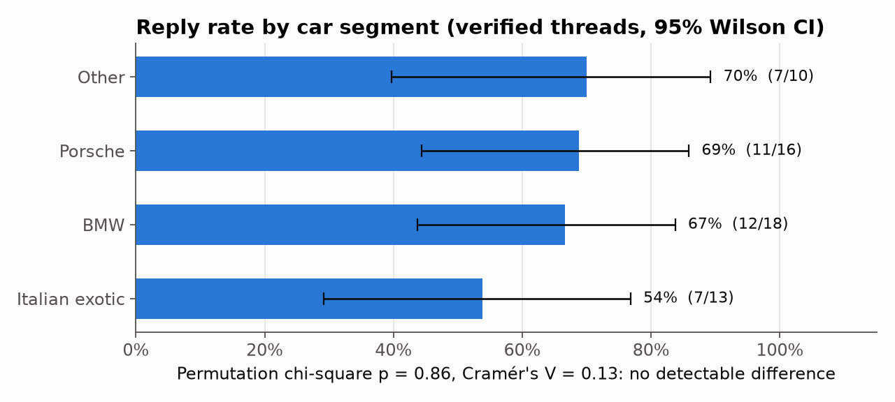
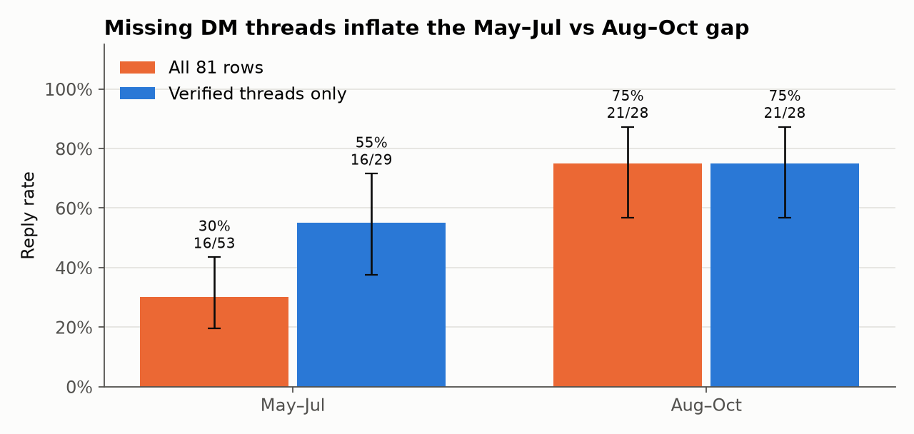
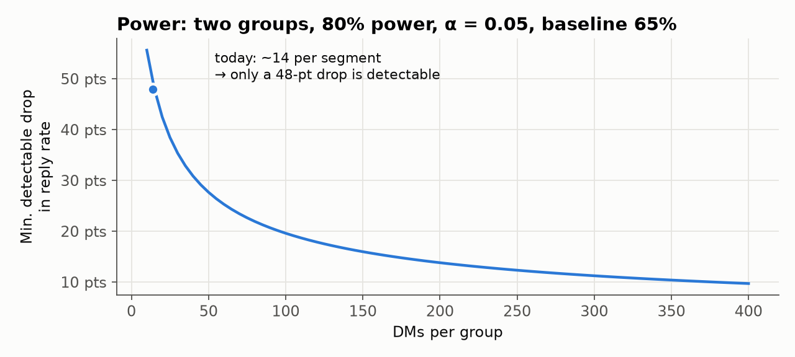

# What makes a car owner reply to a cold DM?

I'm a car videographer. I send cold Instagram DMs to owners of interesting cars to offer a free video shoot.
This project asks: **which owners are more likely to reply, and are any of those differences statistically real?**

**Short answer:** with 81 DMs, none of the group differences hold up once you handle the data properly.
The biggest "effect" in the raw data comes from a measurement problem, not from anything about the owners.

## Data

- 81 DMs sent between 2026-05-12 and 2026-10-01, in 17 sending sessions ("batches"), logged in a Google Sheet.
- Raw columns: date, Instagram handle, car, status, free-text notes. The raw export stays in `data/raw/` and is gitignored.
- `src/dmstats.py` builds `data/processed/dms.csv`. Handles, notes and exact car models are dropped. Each owner gets an ID (`O001`…).
  The notes are used only to derive flags, and then they are discarded.

| field | meaning |
|---|---|
| `segment` | BMW / Porsche / Italian exotic (Ferrari, Lamborghini, McLaren) / Other (JDM, American, Audi, …) |
| `period` | May–Jul vs Aug–Oct |
| `weekday` | day the DM was sent |
| `multi_car` | owner's account features more than one car (collector accounts) |
| `thread_missing` | the DM thread can't be found in the inbox |
| `replied` | owner wrote back at all (**primary outcome**) |
| `shot` | the shoot actually happened |

**Not in the data:** message wording/template and follower count. I never logged them, so the analysis can't test them (see Limits).

## Method

1. **Analysis set.** 24 of 81 rows (30%) have no findable DM thread. **None of them replied, and all 24 were sent in May–Jul.**
   I can't confirm those DMs were ever delivered, so the primary analysis uses the **57 verified threads**.
   All 81 rows are kept as a sensitivity check.
2. **Rates.** Proportions with 95% **Wilson** intervals. Wald intervals behave badly near 0/1 with small n.
3. **Tests.** Four primary hypotheses (segment, period, weekday, multi-car), **Holm-corrected** as one family.
   - r×c tables: chi-square with a **permutation p-value** (20k shuffles), because several expected counts are < 5. Effect size: **Cramér's V**.
   - 2×2: two-proportion z-test plus **Fisher's exact** test. Effect size: **risk difference with a Newcombe CI** and **Cohen's h**.
   - Weekday is constant within a sending batch, so it is permuted **across the 17 send dates**, not across individual DMs.
4. **Logistic regression.** `replied ~ segment + period`, with standard errors clustered by send date.
5. **Power.** Normal-approximation power for two proportions (Cohen's h), via `statsmodels.stats.power`.

## Results

**Overall** (verified threads): **37/57 = 64.9% replied** [51.9%, 76.0%].
22/57 = 38.6% were shot [27.1%, 51.6%], which is 59.5% of the owners who replied.
A naive read of all 81 rows gives 45.7% [35.3%, 56.5%].

| test (verified n = 57) | groups | effect | p (raw) | p (Holm) |
|---|---|---|---|---|
| Car segment | Other 70% (7/10), Porsche 69% (11/16), BMW 67% (12/18), Italian exotic 54% (7/13) | Cramér's V = 0.13 | 0.86 | 0.86 |
| Weekday | Mon 92% (11/12), Tue 100% (7/7), Thu 63% (10/16), Fri 44% (7/16), … | V = 0.49 | 0.106 (date-level) | 0.34 |
| Period | Aug–Oct 75% (21/28) vs May–Jul 55% (16/29) | +19.8 pts [−4.8, +41.3], h = 0.42 | 0.17 | 0.34 |
| Multi-car account | 29% (2/7) vs 70% (35/50) | −41.4 pts [−64.5, −3.3], h = −0.85 | 0.084 | 0.34 |



**The missing-thread rows create a fake period effect.** On all 81 rows, Aug–Oct beats May–Jul by 75% vs 30%
(+44.8 pts [22.1, 61.1], p = 0.0001). Dropping the 24 unverifiable threads shrinks the gap to +19.8 pts, and the
CI then includes 0.



**Weekday looks significant only if batches are ignored.** Treating 57 DMs as independent gives p = 0.008.
Shuffling weekday across the 17 send dates gives p = 0.106. Thursday is essentially one 13-DM batch (10/1), and
Monday's 92% is mostly one 7-for-7 batch (8/3).

**Logistic regression doesn't add much.** Aug–Oct OR = 15.8 [0.88, 283], p = 0.061 (clustered SE). Segment adds
little once period is in the model (LR test p = 0.084, 3 df). The intervals are this wide because segment and period
are almost perfectly confounded: **0 of 18 verified BMW DMs were sent after July**, and 24 of 29 Porsche/exotic DMs
were. The model has 20 non-replies for 4 parameters (EPV = 5), below the usual rule of thumb of ~10.

**Power.** With 28 vs 29 DMs per period, the smallest effect detectable at 80% power is h = 0.74.
The observed period effect (h = 0.42) had only **35% power**.

| to detect… | DMs needed **per group** (α = .05, 80% power) |
|---|---|
| the observed period gap (h = 0.42) | 90 |
| a medium effect (h = 0.5, ≈ 65% vs 41%) | 63 |
| a small effect (h = 0.2, ≈ 65% vs 55%) | 393 |
| Porsche vs BMW as observed (69% vs 67%) | 7,906 |



## Limits

- **Small n.** 57 usable DMs. Every group comparison is underpowered, so a non-significant result here means "can't tell", not "no difference".
- **Not independent.** DMs come in batches that share a day, a message draft, and an account size at that time. The effective sample size is closer to 17 batches than to 57 DMs.
- **Confounded over time.** Target cars (BMW → Porsche/exotics), message wording, portfolio size and follower count all changed together between May and October. Even a significant period effect couldn't be attributed to any one of them.
- **Missing-thread rows.** If some of those DMs really were delivered and ignored, the true reply rate sits between 45.7% and 64.9%.
- **Unmeasured variables.** No message template, follower count, or send time-of-day was logged, so the two most interesting questions (message style, follower count) can't be answered with this data.
- **Observational.** Nothing was randomized, so none of these comparisons are causal.

**What would fix it:** log the template ID and the owner's follower count for each DM, and randomize the template within each batch (an A/B test).
About 60–90 DMs per arm would detect a medium-sized difference.

## How to run

```bash
python -m venv .venv && source .venv/bin/activate
pip install -r requirements.txt
python -m src.dmstats                      # self-check (asserts)
jupyter nbconvert --to notebook --execute --inplace notebooks/analysis.ipynb
```

The anonymized `data/processed/dms.csv` is committed, so the notebook runs as-is. To rebuild it from your own export
(same columns: Date, IG Tag, Car, Response, Notes):

```bash
python -m src.dmstats data/raw/colddms.csv data/processed/dms.csv
```

## Layout

```
src/dmstats.py            cleaning, anonymization, Wilson CI, permutation chi-square, two-proportion tests
notebooks/analysis.ipynb  EDA → tests → regression → power → charts
data/processed/dms.csv    anonymized data (raw export is gitignored)
figures/                  charts used above
```
